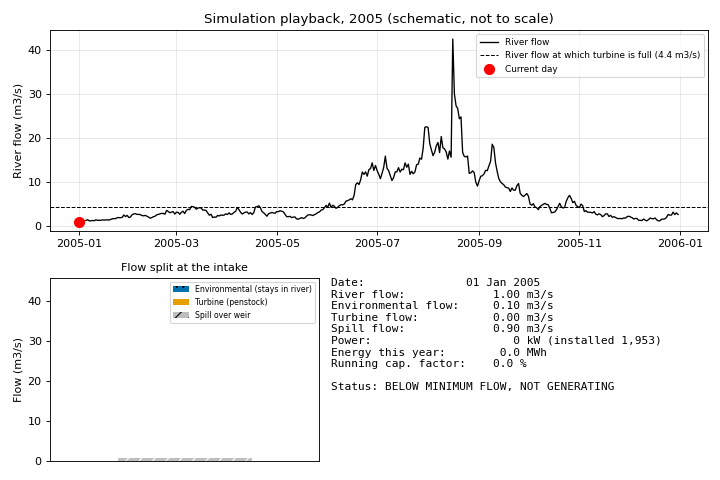

# RiverFlow Lab: Flow Duration Curve and Run-of-River Hydropower Calculator

### 👉 **[Open the interactive web app](https://biswashk920.github.io/RiverFlow-Lab/)** 👈
(runs in your browser, nothing to install; if the link is not live yet, see "Publishing on GitHub Pages" below)

Take a river flow record, build the **flow duration curve (FDC)**, pick a **design flow**, and estimate the
installed capacity, annual energy and capacity factor of a **run-of-river hydropower scheme**. A simulation
playback replays the flow record day by day so you can *see* how river flow becomes electricity.



> **This is a pre-feasibility and learning tool, not a design tool.** The example data are **synthetic**.
> Turbine efficiency curves are **typical simplified assumptions, not manufacturer data**. The animated scene is a
> **schematic**: not to scale, and turbine speed and water motion are illustrative.

## What it does

- Flow record (m³/s), daily or monthly, pasted or from CSV, with friendly messages for missing values, zeros,
  negatives and short records.
- Flow duration curve with Weibull (default), Cunnane, Gringorten, Hazen or Blom plotting positions; Q5 to Q95 table;
  per-year curves and wet/dry season curves (Python version).
- Net head from gross head and head loss (or entered directly); environmental flow as a fixed value or a percentage of
  river flow; Pelton, Francis, Kaplan, cross-flow or constant-efficiency turbine with a minimum operating flow;
  generator and transformer efficiency; plant availability.
- Design flow by exceedance (Q40 and so on) or in m³/s, with a comparison of several design flows.
- Design-flow search: energy versus design flow, the "knee" where extra capacity gives little extra energy, and an
  optional cost-based optimum.
- Simple economics: revenue, simple payback and LCOE (pre-feasibility estimate only).

### Which version does what

| Feature | Python (`hydrofdc`) | Web page (`docs/index.html`) |
|---|---|---|
| Daily data | yes | yes |
| Monthly data | yes | not yet |
| FDC, Q-percentiles, capacity, energy, capacity factor | yes | yes |
| Figures 1 to 4, CSV tables | yes (saved to a folder) | no (summary table and live charts only) |
| Annual and seasonal FDC, comparison of design flows | yes | not yet |
| Energy-vs-design-flow search, knee, cost optimum, economics | yes | not yet |
| Simulation playback with scene, hydrograph and FDC markers | GIF/MP4 of one year | yes, interactive |
| Design-flow slider with live results | no | yes |
| PNG of the scene | no | yes |
| WebM/GIF recording | GIF and MP4 (MP4 needs ffmpeg) | not built (see below) |

## Quick start (Windows, Anaconda Prompt)

```
git clone https://github.com/biswashk920/RiverFlow-Lab.git
cd RiverFlow-Lab
pip install -r requirements.txt
python -m unittest discover -v
python -m hydrofdc run --example --out results
python -m hydrofdc animate --example --year 2005 --out animation.gif
```

`--example` uses the synthetic record with a 60 m gross head and a 10 % environmental flow. These are placeholders.

Your own data (daily or monthly CSV, one column of flows or `date,flow`):

```
python -m hydrofdc run --flows examples/real_data/my_river.csv --gross-head 80 --head-loss 5 ^
  --design-pct 40 --env-mode percent --env-value 10 --turbine kaplan --out results
```

Useful options: `--net-head`, `--design-flow 3.5` (m³/s), `--compare 25,60`, `--compare-flows 2,3.5`,
`--const-eta 0.88`, `--min-flow`, `--availability`, `--position cunnane`, `--log`, `--seasonal`, `--tariff` with
`--capex-per-kw` (economics), `--fill interpolate`. Run `python -m hydrofdc run --help` for all of them.
Python results are written to the folder given by `--out` (tables as CSV, figures as PNG).

## Run the web page on your own computer

```
cd docs
python -m http.server 8000
```

Open http://localhost:8000 . Do not just double-click `index.html`: the page works, but the "Load example" button is
blocked by the browser that way (use the file chooser with `examples/synthetic_daily.csv` instead).

## How the calculations work

| Item | Formula |
|---|---|
| Exceedance probability | P = (m − a) / (n + 1 − 2a), m = rank (1 = largest flow). Weibull has a = 0, so P = m/(n+1) |
| Net head | H_net = H_gross × (1 − loss %) |
| Usable flow, each time step | min(river flow − environmental flow, design flow); zero if below the minimum operating flow |
| Power | P = η ρ g Q H_net / 1000 (kW), with η = turbine × generator × transformer efficiency |
| Energy, each time step | P × hours × availability |
| Installed capacity | power at the design flow |
| Capacity factor | total energy ÷ (installed capacity × record hours) |
| Average annual energy | total energy ÷ (record hours ÷ 8766) |
| LCOE | (capital × capital-recovery factor + O&M) ÷ annual energy |

**Design flow** is the flow through the turbine. If you choose Q40, the tool reads the river flow exceeded 40 % of the
time and removes the environmental flow at that flow. **Net head** is gross head minus losses in the penstock.
**Capacity factor** is the average power divided by installed capacity. **Exceedance probability** is the share of time a
flow is equalled or exceeded.

Missing steps are excluded by default (the record length is counted from valid steps only); `--fill interpolate`
fills gaps by straight lines instead.

## Validation and tests

Run `python -m unittest discover -v` (Python, 32 tests) and, if Node.js is installed, `node tests/test_web.js`.

| Check | Where |
|---|---|
| Q = 2 m³/s, net head 50 m, total efficiency 0.85 gives 0.85 × 1000 × 9.81 × 2 × 50 = **833.85 kW**; over 8760 h that is **7.30 GWh** | both |
| Constant flow gives a flat FDC and capacity factor exactly 1 when design flow equals that flow | both |
| Weibull exceedance of the largest flow is 1/(n+1), of the smallest n/(n+1) | both |
| Energy never exceeds that of a plant using all flow up to the design flow, with the best turbine efficiency | Python |
| Browser results equal Python results on the same inputs (4 cases, tolerance 1e-9) | Node, using `tests/fixtures/web_cases.json` written by `python -m tests.make_fixtures` |
| Animation: the energy total at the end of playback equals the calculated total exactly; scrubbing to a date gives the same numbers as playing to it | Node |

Note: over a 365-day record the energy is exactly 7.30 GWh. The "average annual energy" divides by a 365.25-day year,
so the same plant shows 7.31 GWh.

**Synthetic data:** `examples/synthetic_daily.csv` is generated by `examples/make_synthetic.py` (fixed random seed,
monsoon-like seasons). It is **not a real river**. No published flow record or manufacturer turbine data are used.

**What was not tested in a real browser:** all drawing, layout, buttons, scrubber, dragging, dark mode, the
reduce-motion and hidden-tab behaviour, PNG saving and the "Load example" button. Only the calculation and the
animation state logic are tested (with Node). Please report anything that looks wrong.

## Use your own real record

Put a CSV from your local hydrology department in `examples/real_data/` (see the note there). That folder is ignored by
Git so your data are not uploaded. Run the Python command above, then load the same file in the web page
("Or load a CSV file") and compare the Q-percentiles and capacity factor against the synthetic example.

## About the animation

- The scene shows the intake weir, penstock, powerhouse and tailrace. Stream widths are proportional to flow
  (environmental, turbine and spill). The river level, water motion and runner speed rise with flow, and the runner
  stops with the label "Below minimum flow, not generating". These visual effects are **illustrative, not to scale**.
- Every number comes from a table of per-step values calculated once; drawing only reads it. That is why scrubbing and
  playing give identical values.
- The page starts paused if your system asks for reduced motion, and pauses when the tab is hidden.
- **Recording the web version:** press `Win + Alt + R` (Xbox Game Bar; or `Win + G`) while the page plays, then
  convert the clip to GIF with a tool of your choice. A built-in WebM/GIF export is **not** included: a browser cannot
  make GIFs without a heavy extra library, and in-browser WebM recording was not built or tested.
- The README animation was made with `python -m hydrofdc animate --example --year 2005 --out docs/animation_example.gif`.

## Limitations

No reservoir storage or peaking; fixed head (no tailwater or head change with flow); simplified turbine efficiency
curves; no sediment or ice effects; no climate change; long records (commonly 10 years or more) are needed for reliable
estimates; monthly averages smooth out floods and understate energy at high design flows; economics ignore
construction time, tax, inflation, degradation and civil-cost scaling.

## Project layout

```
RiverFlow-Lab/
├── README.md  LICENSE  .gitignore  requirements.txt
├── hydrofdc/          Python package (data, fdc, plant, optimum, economics, plots, animate, cli)
├── docs/              index.html (web app), synthetic_daily.csv, animation_example.gif
├── examples/          make_synthetic.py, synthetic_daily.csv, results/, real_data/
└── tests/             test_core.py, test_outputs.py, test_web.js, make_fixtures.py, fixtures/
```

Datasets are not committed (see `.gitignore`), except the synthetic example the web page and tests need.

## Publishing on GitHub Pages

Repository **Settings → Pages → Build and deployment → Source: Deploy from a branch → Branch: `main`, folder: `/docs`
→ Save**. After a minute the app is live at https://biswashk920.github.io/RiverFlow-Lab/ .

## License

MIT, see [LICENSE](LICENSE). Copyright (c) 2026 Biswash Kaphle.
